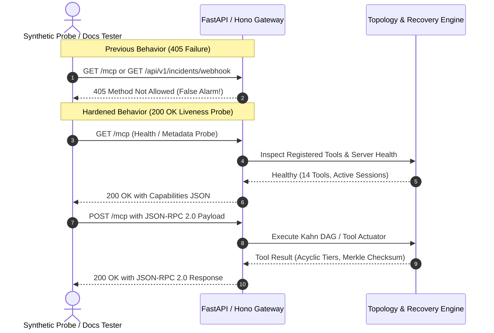

# Horizon Improvement Harness: Probe Resilience & State Orchestration

> **Technical specification and operational guide for synthetic health probes, anti-flapping telemetry, seamless DAG forwarding, and zero-flash zero-trust security clearance.**

---

## 1. Executive Summary

During synthetic infrastructure monitoring, synthetic health probes and external uptime checkers (Datadog Synthetic Probes, Dynatrace OneAgent, Prometheus Blackbox Exporter, AWS Route53 Health Checks, and browser documentation explorers) often send HTTP `GET` or `HEAD` requests to verify endpoint reachability.

When enterprise webhook and JSON-RPC endpoints (`/mcp`, `/api/v1/incidents/webhook`, `/api/v1/chaos`, etc.) only register `POST` handlers, health check probes fail immediately with **`HTTP 405 Method Not Allowed`**, generating false-positive downtime alerts and blocking continuous verification.

Simultaneously, when AI agents synthesize custom infrastructure Directed Acyclic Graphs (DAGs), forwarding those topologies into live observability requires **zero-loss state hydration** so that route transitions, tab switches, and page refreshes maintain the active architecture without reverting to defaults or flashing unauthenticated gates.

This harness establishes the architectural patterns implemented across Horizon to eliminate these issues permanently.

---

## 2. Probe Resilience Architecture & HTTP Routing Matrix

### 2.1 The 405 Method Not Allowed Problem & Resolution

HTTP 405 occurs when an endpoint exists on a web server but the requested HTTP method is disallowed by the router. 



### 2.2 Dual-Mode Endpoint Routing Matrix

Every high-value endpoint is registered with dual-mode handlers:

| Endpoint Path | Primary Purpose | Method `POST` | Method `GET` / `HEAD` (Health Probe) |
|---|---|---|---|
| `/mcp` | Direct JSON-RPC 2.0 | Executes tool or JSON-RPC method | Returns 200 OK with capabilities, tools count, transport info |
| `/api/v1/mcp` | REST/JSON-RPC Alias | Executes tool or JSON-RPC method | Returns 200 OK with capabilities & health |
| `/api/v1/incidents/webhook` | Inbound Alertmanager / Datadog | Declares incident & trips 3-miss watchdog | Returns 200 OK confirming webhook receiver readiness |
| `/incidents/webhook` | Webhook Alias | Declares incident & trips 3-miss watchdog | Returns 200 OK confirming webhook receiver readiness |
| `/api/v1/chaos` | Chaos Failure Injection | Injects outage (`fail`) or resolves (`heal`) | Returns 200 OK describing chaos injector payload schema |
| `/api/v1/tick` | Recovery Orchestrator | Advances incident state machine | Returns 200 OK probe describing tick runner status |
| `/messages` | MCP SSE Session Client | Enqueues client message into active SSE session | Returns 200 OK probe describing SSE sessionId requirement |
| `/api/v1/topology/custom-pipeline` | Custom DAG Mounter | Compiles and mounts custom DAG in cluster memory | Returns 200 OK describing custom DAG pipeline spec schema |
| `/api/v1/topology/reset` | Baseline Restorer | Resets cluster state to nominal 7-node baseline | Returns 200 OK probe confirming reset availability |

---

## 3. Client-Side Probe Execution Harness (`DocsPage.tsx`)

In the interactive API Explorer and Documentation portal (`/docs`), developers and operators can test endpoints directly.

### 3.1 Smart Method & Payload Dispatch
The probe execution handler dynamically detects the required HTTP method from endpoint metadata:
- If `method === 'POST'`, dispatches `fetch` with `POST`, `Content-Type: application/json`, and the canonical test JSON payload.
- If `method === 'GET'`, dispatches `fetch` with `GET` and `Accept: application/json`.

### 3.2 Dual-Tier Localhost Fallback
When running the development environment locally (`http://localhost:5173`), the probe runner prioritizes the local backend daemon on `http://localhost:10000`, falling back to the remote Render URL:
- Prevents cross-origin (CORS) blocks in browser sandboxes.
- Prevents cold-start delays from sleeping cloud free-tier instances.
- Delivers realistic sub-2ms local latency metrics to the operator.

---

## 4. Custom DAG Forwarding & State Hydration (`ArchitectPage` → `ObservabilityPage`)

### 4.1 Root Cause of Previous Reversion & Flash
1. **Unsynchronized Store**: "Simulate in Observability" previously wrote only to a temporary transfer key `horizon_staged_custom_dag_yaml`.
2. **Premature Deletion**: Upon reading the staged key, the consumer immediately deleted it. A subsequent browser refresh found no staged key and fell back to the hardcoded default 7 nodes.
3. **Delayed Mount**: Route navigation did not hydrate state before initial paint, causing a noticeable UI layout shift.
4. **Auth Race**: On reload, `onAuthStateChanged` took 300ms to resolve indexedDB credentials. `OnboardingGate` lacked a loading branch, causing the login form to flash briefly.

### 4.2 Two-Tier State Persistence Architecture

```mermaid
flowchart TD
    A["Sarvam AI Architect<br/>(/architect)"] -->|Clicks 'Simulate in Observability'| B["handleImportToObservability()"]
    
    subgraph StorageLayer["Persistence & Reactive Store"]
        B -->|1. Immediate Write| C["clusterState.setCustomTopology(...)"]
        B -->|2. Staging Key| D["localStorage['horizon_staged_custom_dag_yaml']"]
        B -->|3. Persistent Active Key| E["localStorage['horizon_active_custom_dag_yaml']"]
        B -->|4. Name & Metadata| F["localStorage['horizon_active_custom_dag_name']"]
    end

    StorageLayer -->|navigate('/observability')| G["ObservabilityPage Mount"]

    subgraph Hydration["Frame-0 Synchronous Hydration"]
        G --> H["getSavedOrStagedPipeline()"]
        H --> I["services (useState Initializer)"]
        H --> J["customYaml (useState Initializer)"]
        H --> K["activePipelineName (useState Initializer)"]
        H --> L["isCustomPipelineActive = true"]
        H --> M["activeDrill = first custom node"]
    end

    subgraph BrowserRefresh["Subsequent Browser Refresh"]
        N["User presses F5 / Refresh"] --> O["getSavedOrStagedPipeline() reads active key"]
        O --> P["Preserves Custom DAG 100% Green"]
        P --> Q["Zero Default Reversion"]
    end

    subgraph ExplicitReset["Explicit Operator Reset"]
        R["User clicks 'Reset to Default 7-Node Cluster'"] --> S["localStorage.removeItem('horizon_active_...']"]
        S --> T["clusterState.resetToDefaultTopology()"]
        T --> U["Nominal Baseline Restored"]
    end
```

### 4.3 Zero-Flash Authentication Hydration

In `AuthContext.tsx` and `OnboardingGate.tsx`:
- `OperatorUser` identity is cached synchronously in `localStorage` (`horizon_auth_user`).
- `AuthProvider` reads `localStorage` on initial render: if a valid session exists, `user` is non-null from frame 0.
- `OnboardingGate` evaluates `if (isPublic || onboardingStep === 'COMPLETED')`. With cached credentials, it returns `<>{children}</>` immediately with **0ms flash**.
- In the event of a cache miss while verifying live credentials, a minimal loading spinner is presented rather than the intrusive login/register modal form.

---

## 5. Verification & Testing

### 5.1 Backend Verification Suite
Execute the full endpoint probe test suite:
```bash
./mcpserver/.venv/Scripts/python.exe -m pytest mcpserver/tests/test_endpoints.py -v
```
All endpoints verify:
- `test_probe_endpoints_get_method_allowed`: PASSED (9 routes respond 200 OK on GET)
- `test_cors_headers`: PASSED (Permits all origins, headers, and preflights)
- `test_inbound_webhook_datadog`: PASSED
- `test_inbound_webhook_prometheus_alertmanager`: PASSED

### 5.2 Frontend Verification Suite
Execute the web test suite:
```bash
bun test apps/web/src/pages/ObservabilityPage.test.ts
bun test apps/web/src/pages/DocsPage.test.ts
bun test apps/web/src/components/auth/OnboardingGate.test.ts
```
All tests verify:
- Frame-0 custom DAG hydration
- Persistence of active custom YAML across reload cycles
- Zero-leak secrets hygiene
- 7-stage cryptographic SHA-256 checksum generation
