# Horizon Web Console — Frontend Architecture & Technical Report

> **Mission-Control SRE War Room & Autonomous Infrastructure Recovery Console**  
> *Built with React 19, TypeScript (Strict Mode), Vite, Bun Runtime, Tailwind CSS v4, DaisyUI, and Web3 BridgeKey Wallet on the MST Blockchain.*

---

## 📌 Overview

The **Horizon Web Console** (`apps/web`) is the user-facing command center of the Horizon resilience ecosystem. Designed in a high-contrast **Neo-Brutalistic** visual language with glassmorphism accents and bento-grid layouts, it provides Site Reliability Engineers (SREs), Incident Commanders, and CISOs with real-time topological visibility, continuous APM telemetry ingestion, simulated chaos failure injection, and cryptographic Web3 governance.

---

## 🎨 Design System & Visual Tokens

- **Theme**: Light Mode Neo-Brutalist
  - **Cream Canvas**: `#FFF8F0`
  - **Onyx Ink**: `#1A1A1A`
  - **Cobalt Blue (Primary Brand)**: `#0047AB`
  - **Muted Earth Tone**: `#5A4E44` / `#E5D7C5`
- **Typography**: Poppins font stack with monospace telemetry overlays.
- **Component Standard**: Strict adherence to accessibility (WCAG 2.1 AA) and `cn()` utility class merging. Every component accepts a `className` prop for downstream extensibility.

---

## 📜 Deployed Smart Contracts & MST Blockchain Integration

The frontend connects directly to the **MST Blockchain Testnet** via standard JSON-RPC and injected Web3 providers (**BridgeKey Wallet** / EIP-1193):

| Contract | Type | Address | Network | Explorer |
| :--- | :---: | :--- | :--- | :--- |
| **HorizonSubscriptionNFT** | ERC-721 (`ZXPASS`) | `0x3EDad230dCFc6Dd3C357490b9feDa49639646BB7` | MST Testnet (`91562037`) | [View Contract](https://testnet.mstscan.com/token/0x3EDad230dCFc6Dd3C357490b9feDa49639646BB7) |
| **HorizonAuditVault** | Merkle Audit Vault | `0x8192305827361a29384756281938472619284756` | MST Testnet (`91562037`) | [View Contract](https://testnet.mstscan.com/address/0x8192305827361a29384756281938472619284756) |

### Blockchain Configuration
- **RPC URL**: `https://testnetrpc.mstblockchain.com`
- **Chain ID**: `91562037` (Hex: `0x5752b05`)
- **Explorer**: `https://testnet.mstscan.com`
- **Authorized Commander Wallets**:
  - `0x73595081334A18D4298A160b162faB4Fb4B3c85B`
  - `0x7FC1d02922d4865fd53De59697407a42e64d1Cad`
  - `0x8cA0f3176997F32CCBb4598Fc8C966C95aeEEc9e`
  - `0x71C8360216b7e0dfBE7A9cDE7eBaeA2b53b8110b`

---

## 📐 Frontend Architecture Diagram

```mermaid
flowchart TD
    subgraph UI_Layer["User Interface & Bento Grid Views"]
        Nav["Navigation Bar & Platform Menu"]
        ObsView["Observability Hub (/observability)"]
        TopoView["Topology Canvas (/topology)"]
        AuditView["Audit Vault Explorer (/audit)"]
        SubView["NFT Subscription Plans (/subscription)"]
        ArchView["AI Mesh Architect (/architect)"]
        Copilot["Floating Sarvam AI SRE Copilot"]
    end

    subgraph State_Engine["Core Client Engines (src/engine/)"]
        GraphEngine["Kahn's DAG Sequencer<br/>(dependencyGraph.ts)"]
        WatchdogEngine["Anti-Flapping Sliding Watchdog<br/>(watchdog.ts)"]
        ClusterState["Cluster State Manager<br/>(state.ts)"]
        SarvamClient["Sarvam AI Agent<br/>(sarvamAgent.ts)"]
        Web3Service["MST Blockchain Service<br/>(mstBlockchain.ts)"]
        ChecksumGen["Pipeline Checksum Generator<br/>(pipelineChecksum.ts)"]
    end

    subgraph External_Services["External Telemetry & Blockchain"]
        MST_RPC["MST Testnet RPC (Chain ID 91562037)"]
        BridgeKeyWallet["BridgeKey Injected Wallet Provider"]
        SarvamCloud["Sarvam AI Cloud LLM (api.sarvam.ai)"]
        FirebaseRTDB["Firebase Realtime Database"]
    end

    ObsView & TopoView <--> ClusterState
    ClusterState <--> GraphEngine
    WatchdogEngine -->|Trip Alerts| ClusterState
    Copilot <--> SarvamClient
    AuditView <--> Web3Service
    SubView <--> Web3Service
    ChecksumGen --> ClusterState

    Web3Service <--> BridgeKeyWallet & MST_RPC
    SarvamClient <--> SarvamCloud
    ClusterState <--> FirebaseRTDB
```



---

## ⚡ Primary Views & Feature Highlights

1. **Observability Hub (`ObservabilityPage.tsx`)**:
   - Real-time Datadog/Dynatrace APM telemetry simulation (latency waves, error rates, CPU load).
   - 3-consecutive-miss sliding window watchdog status indicator.
   - PagerDuty P1 critical alarm banner with synthesized audio chime.
   - 7-Stage Cryptographic Checksum Manifest matrix with one-click copy.
2. **Topology Canvas (`TopologyPage.tsx`)**:
   - Interactive dependency graph visualizer.
   - Live BFS cascaded blast radius highlighting.
   - Bottom-up topological execution tier breakdown (Tiers 0 through 3).
3. **Sarvam AI SRE Copilot (`sarvamAgent.ts`)**:
   - Multilingual natural language command bar (English, Hindi, Hinglish, Tamil, Marathi, Spanish, French).
   - Dual-engine fallback: Original Sarvam Cloud (`sarvam-2b` / `sarvam-105b`) with green `HTTP 200` badge, and local deterministic heuristic guardrail.
4. **Web3 Subscription Portal (`SubscriptionPage.tsx`)**:
   - ERC-721 token-gated pass minting (`ZXPASS`).
   - AutoLogging rate limits: 5 (Explorer), 10 (Guardian), 15 (Sentinel), 20 (Enterprise) events/min.
   - Automatic EIP-747 wallet asset registration (`wallet_watchAsset`).
5. **Cryptographic Audit Vault (`AuditPage.tsx`)**:
   - Tamper-evident incident history viewer.
   - Direct verification against `HorizonAuditVault.sol` smart contract on MSTScan.
6. **AI Mesh Architect (`ArchitectPage.tsx`)**:
   - Synthesizes full Kubernetes CRDs, Docker Compose files, and topological graphs from plain English prompts.

---

## 🚀 Development Quickstart

### Prerequisites
- **Bun** v1.2+ (*Do NOT use npm, yarn, or pnpm*)
- Modern browser with **BridgeKey Wallet** installed

### Run Locally
```bash
# From workspace root:
bun install
bun run dev

# Or directly in apps/web:
cd apps/web
bun install
bun run dev
```
Open **`http://localhost:5173`** in your browser.

### Run Tests & Build
```bash
# Execute unit tests
bun test

# Production build check
bun run build
```

---

## 📄 License
MIT License. Developed for enterprise infrastructure resilience and hackathon evaluation.