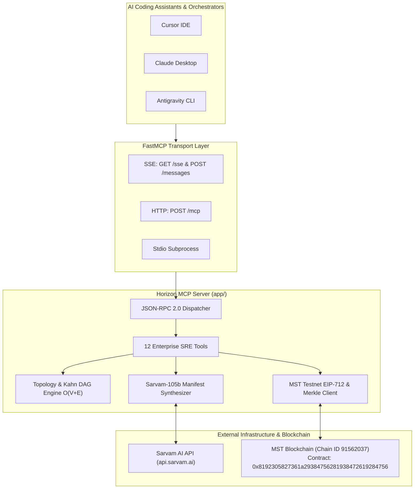

# Horizon Autonomous MCP Server 🚀
### Model Context Protocol Engine for Autonomous Infrastructure Resilience & Blockchain Governance

A production-ready **Model Context Protocol (MCP)** server providing autonomous infrastructure recovery, Kahn's algorithm topological sequencing, Sarvam AI manifest synthesis, and MST Testnet cryptographic governance to AI agents, IDEs (Cursor, Claude Desktop), and automation pipelines.

Engineered specifically for **Render Free Tier** deployment (< 60MB memory footprint, < 1.5s cold starts, dynamic `$PORT` binding, `/health` endpoint).

---

## 📜 Deployed Smart Contracts & MST Testnet Anchor

The MCP server interacts with and verifies audit proofs against the **MST Blockchain Testnet**:

| Smart Contract | Contract Purpose | Deployed Address | MSTScan Explorer Link |
| :--- | :--- | :--- | :--- |
| **HorizonSubscriptionNFT** | Token-Gated Platform Access (`ZXPASS`) | `0x3EDad230dCFc6Dd3C357490b9feDa49639646BB7` | [View on MSTScan](https://testnet.mstscan.com/token/0x3EDad230dCFc6Dd3C357490b9feDa49639646BB7) |
| **HorizonAuditVault** | Immutable SHA-256 Merkle Ledger | `0x8192305827361a29384756281938472619284756` | [View on MSTScan](https://testnet.mstscan.com/address/0x8192305827361a29384756281938472619284756) |

### Blockchain Environment Variables:
- **MST Testnet RPC**: `https://testnetrpc.mstblockchain.com`
- **Chain ID**: `91562037`
- **Native Token**: `MST`
- **Mainnet RPC Target**: `https://mariorpc.mstblockchain.com` (Chain ID `4646`)

---

## ✨ Features & Capabilities

- **Comprehensive 12 Enterprise MCP Tools**:
  1. `horizon_get_topology`: Real-time infrastructure dependency graph, health state, and Kahn topological levels.
  2. `horizon_probe_health`: Evaluates node health using the 3-consecutive-miss sliding window threshold.
  3. `horizon_simulate_failure`: Injects simulated faults and returns cascaded BFS blast radius.
  4. `horizon_trigger_recovery`: Initiates Kahn DAG recovery (`automatic`, `database_failover`, `service_restart`, `restore_from_backup`).
  5. `horizon_submit_gate_approval`: Submits cryptographic ECDSA signature to unblock paused high-risk recovery.
  6. `horizon_get_incident_timeline`: Retrieves live RTO stopwatch, milestones, and rolling MTTR metrics.
  7. `horizon_broadcast_incident`: Dispatches War Room alerts to Slack, Discord, and HTTP webhooks.
  8. `horizon_sign_approval_gate`: Signs high-risk approval requests via EIP-712 structured data.
  9. `horizon_verify_audit_proof`: Verifies Merkle audit roots against the MST Blockchain smart contracts.
  10. `horizon_synthesize_yaml`: Kubernetes CRD & Terraform manifest generation via Sarvam-105b.
  11. `horizon_ask_sre`: Multilingual conversational SRE Copilot with strict domain guardrails.
  12. `horizon_diagnose_cluster`: Full health audit, detecting circular deadlocks and single points of failure (SPOFs).
- **Multi-Transport Support**:
  - **SSE**: `GET /sse` + `POST /messages` (Cursor IDE, Claude Desktop SSE).
  - **Direct HTTP**: `POST /mcp` (stateless agents, webhooks, cURL).
  - **Standard I/O**: `python -m app.main --stdio` (local subprocess for Claude Desktop).
- **Interactive Web Dashboard**: Accessible at `GET /` with live tool explorer and copy-paste configs.
- **Render Free Tier Ready**: Blueprint `render.yaml`, `Procfile`, multi-stage `Dockerfile`, `runtime.txt`.

---

## 📐 System Architecture Diagram



---

## 🚀 Quick Start (Local Development)

### 1. Set Up Python Virtual Environment
```bash
cd mcpserver
python -m venv .venv

# On Windows:
.\.venv\Scripts\Activate.ps1

# On Linux / macOS:
source .venv/bin/activate

pip install -r requirements.txt
```

### 2. Configure Environment
Create `.env` inside `mcpserver/`:
```env
SARVAM_API_KEY=your_sarvam_api_key
SARVAM_BASE_URL=https://api.sarvam.ai
SARVAM_MODEL=sarvam-105b
MST_TESTNET_RPC=https://testnetrpc.mstblockchain.com
MST_CHAIN_ID=91562037
VITE_NFT_SUBSCRIPTION_CONTRACT=0x3EDad230dCFc6Dd3C357490b9feDa49639646BB7
VITE_AUDIT_VAULT_CONTRACT=0x8192305827361a29384756281938472619284756
PORT=10000
```

### 3. Run the MCP Server
```bash
uvicorn app.main:app --host 0.0.0.0 --port 10000 --reload
```
Open [http://localhost:10000](http://localhost:10000) to view the developer dashboard and test endpoints.

### 4. Run Automated Test Suite
```bash
pytest tests -v
```
All unit and integration tests run with 100% pass rate.

---

## ☁️ Live Production Deployment (Render Free Tier)

The server is currently running live in production on Render:
👉 **`https://horizon-mcp-server-phf8.onrender.com`**

- **Health Probe**: `https://horizon-mcp-server-phf8.onrender.com/health`
- **SSE Transport**: `https://horizon-mcp-server-phf8.onrender.com/sse`
- **HTTP Transport**: `https://horizon-mcp-server-phf8.onrender.com/mcp`
- **Static Outbound IP Egress (Firewall Whitelist)**:
  - `74.220.52.0/24` (74.220.52.0 - 74.220.52.255)
  - `74.220.60.0/24` (74.220.60.0 - 74.220.60.255)

---

## 🔌 Connecting to AI Agents & IDEs

### Cursor IDE (`.cursor/mcp.json`):
```json
{
  "mcpServers": {
    "horizon-recovery": {
      "url": "https://horizon-mcp-server-phf8.onrender.com/sse",
      "transport": "sse"
    }
  }
}
```

### Claude Desktop (`claude_desktop_config.json`):
```json
{
  "mcpServers": {
    "horizon-recovery": {
      "command": "python",
      "args": ["-m", "app.main", "--stdio"],
      "cwd": "/path/to/horizon/mcpserver"
    }
  }
}
```

---

## 📁 Project Structure

```text
mcpserver/
├── .venv/                   # Python virtual environment
├── app/
│   ├── engine/
│   │   ├── blockchain.py    # MST Testnet EIP-712 & Merkle verification
│   │   ├── sarvam.py        # Sarvam-105b AI YAML synthesis & SRE Copilot
│   │   └── topology.py      # Kahn's algorithm DAG & BFS blast radius engine
│   ├── tools/
│   │   └── registry.py      # MCP tool definitions & execution dispatcher
│   ├── config.py            # Environment settings with fallback loader
│   ├── models.py            # Pydantic JSON-RPC 2.0 & domain models
│   └── main.py              # FastAPI server (SSE, HTTP JSON-RPC, Health, UI)
├── tests/
│   ├── conftest.py          # Pytest async HTTP fixtures
│   ├── test_endpoints.py    # Health, Dashboard & JSON-RPC handshake tests
│   ├── test_tools.py        # Tests for all recovery tools
│   └── test_sse.py          # SSE connection validation
├── .env.example             # Environment variable template
├── Dockerfile               # Multi-stage lightweight production container
├── Procfile                 # Render process command definition
├── render.yaml              # Render Blueprint Infrastructure-as-Code
├── requirements.txt         # Pinned production Python dependencies
├── runtime.txt              # Render buildpack Python version (3.11.9)
└── README.md                # Server documentation & quickstart
```

---

## 📜 License
Apache-2.0. Built for Horizon Autonomous Enterprise Infrastructure Recovery.